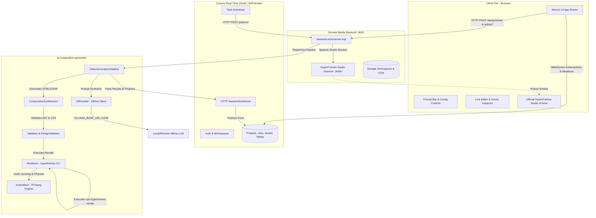
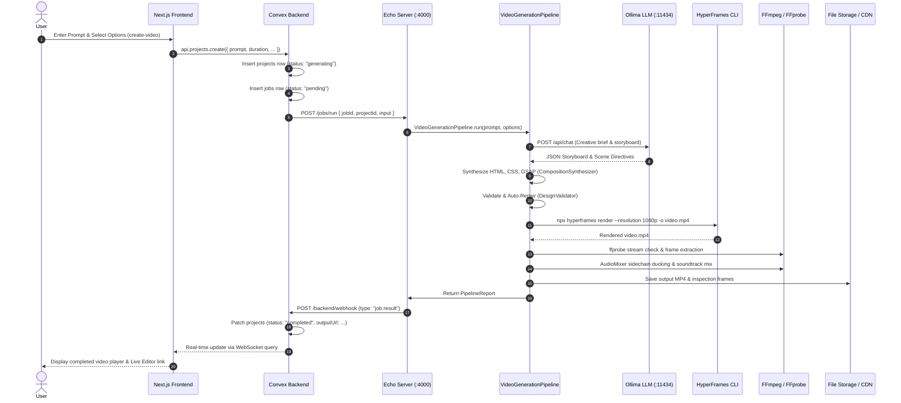
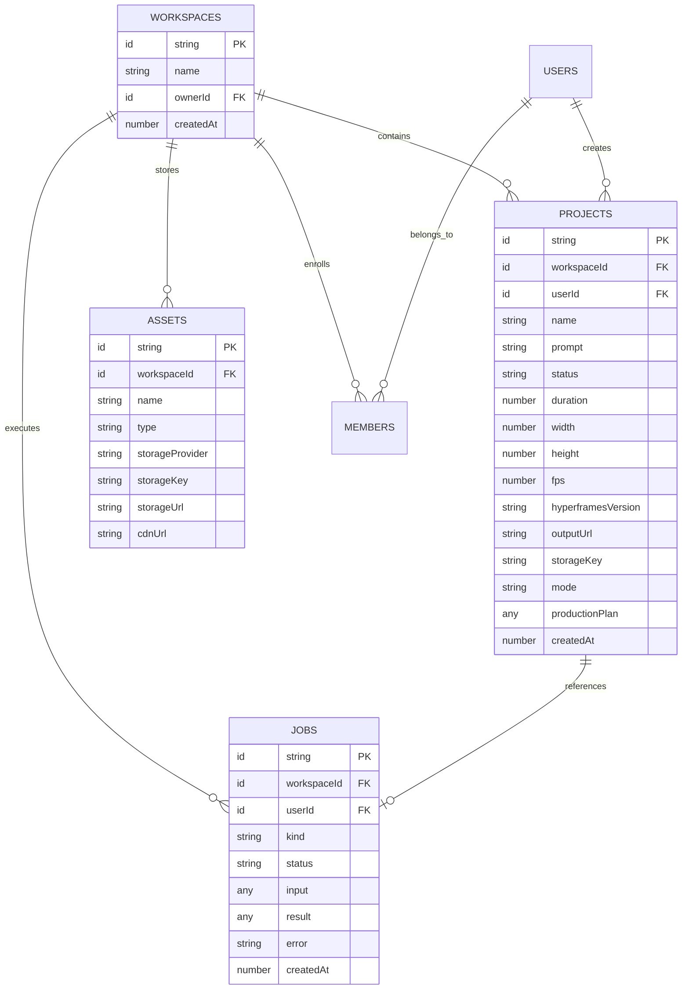
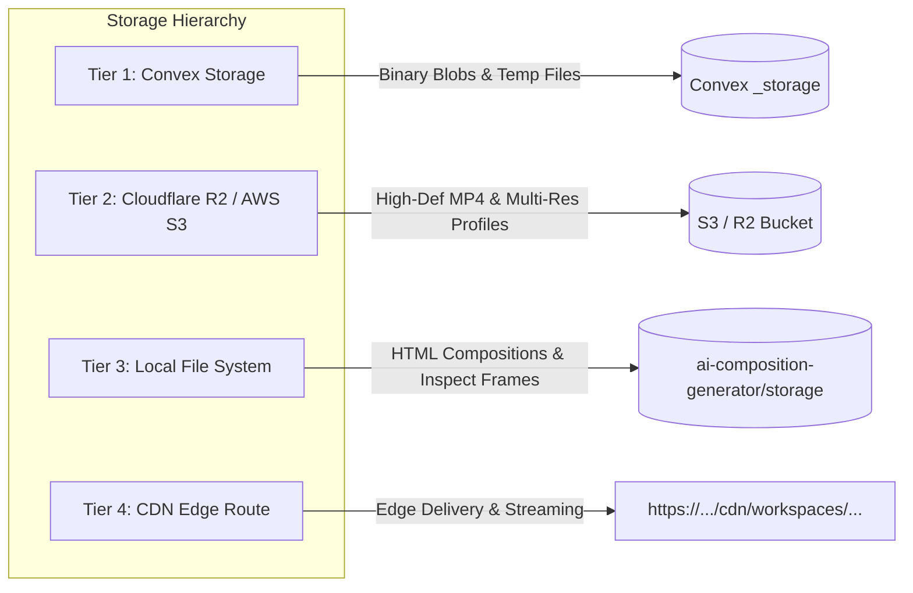
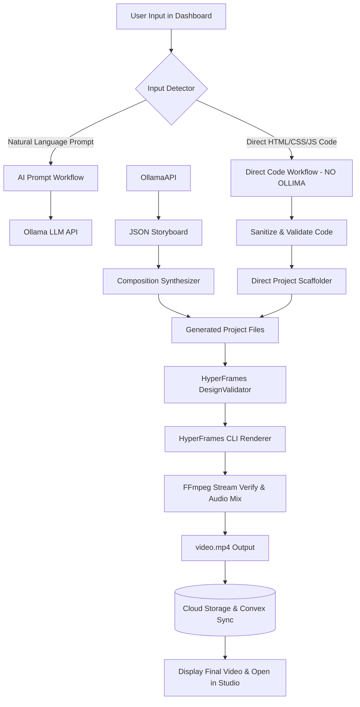
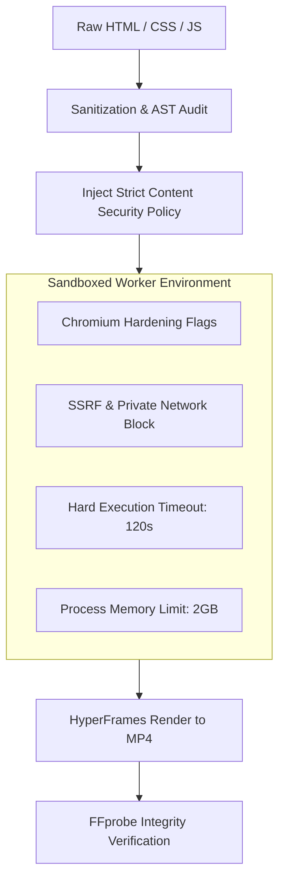
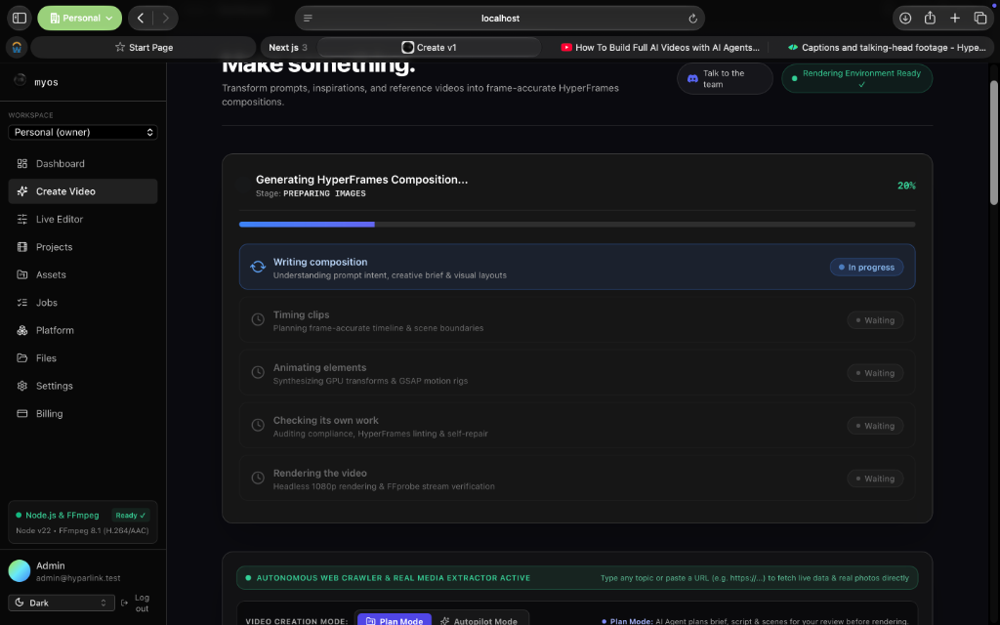
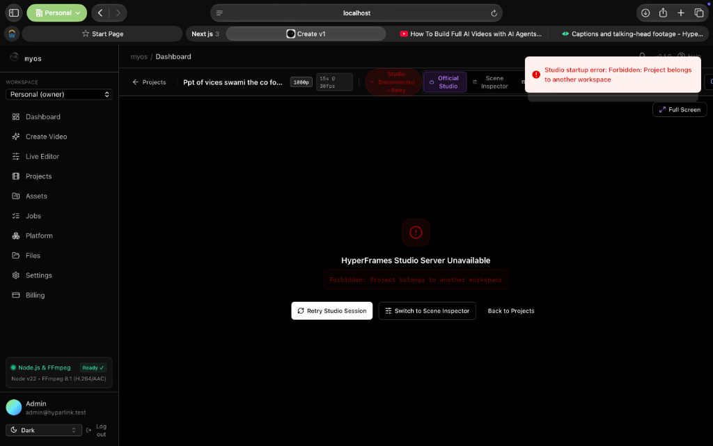
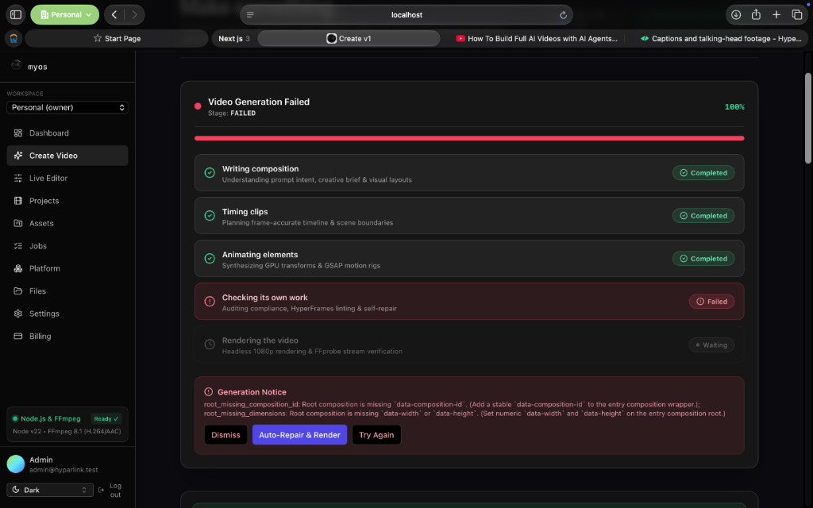
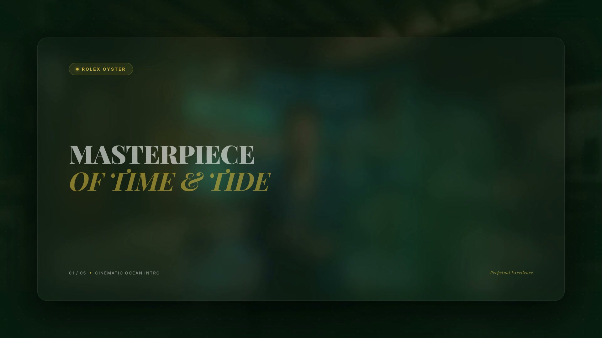

# Hyperlink / HyperFrames Video Generation Dashboard
## Comprehensive System Architecture Audit & Engineering Report

**Audit Date:** October 16, 2026  
**Audited Target:** Hyparlink Web Dashboard, Convex Backend, Ollima AI Engine, and HyperFrames Video Generation Pipeline  
**Workspace Root:** `/Users/apple/Desktop/hyparlink dashbord`  
**Audit Purpose:** Inspect, document, and report existing application architecture; verify frontend, Convex, Ollima, HyperFrames, and FFmpeg implementations; and design an architecture blueprint for adding a direct HTML/CSS/JavaScript video creation workflow that operates completely without Ollima.

---

## 1. Executive Summary

This architecture audit provides an exhaustive, evidence-based technical inspection of the **Hyparlink / HyperFrames Video Generation Dashboard**. The system is a full-stack, enterprise-grade video creation platform enabling users to produce broadcast-quality 1080p video compositions using modern web technologies (HTML, CSS, GSAP, SVG), autonomous AI planning, digital avatar synthesis, intelligent soundtrack scoring, and high-performance rendering.

### Primary Audit Findings

1. **Frontend Architecture:** The user interface is built on **Next.js 14.2.7 (App Router)** and **React 18.3.1**, styled with **TailwindCSS** and **shadcn/ui** components. Core pages include the video creation studio (`create-video/page.tsx`), a two-tier live editor (`editor/[projectId]/page.tsx`) with embedded HyperFrames Studio, a workspace asset manager (`assets/page.tsx`), and real-time job monitors (`jobs/page.tsx`).
2. **Backend Architecture:** The application operates a **hybrid backend**:
   - **Convex (v1.19.2):** Serves as the primary real-time database, authentication provider, multi-tenant workspace governor, and asynchronous job scheduler.
   - **Node.js Echo Server (`backend-echo/server.mjs`):** Acts as the domain media engine, handling local process orchestration, file system project mapping, external AI completions, storage synchronization, and HyperFrames Studio sessions on dedicated ports.
3. **Ollima AI Integration:** Deeply integrated into `ai-composition-generator/src/ai/provider.ts`. It supports both native Ollima endpoints (`/api/chat`) and OpenAI-compatible endpoints (`/v1/chat/completions`) using structured JSON outputs (`format: "json"` or `response_format: { type: "json_object" }`). Prompts are orchestrated through `StoryboardPlanner` and `ScenePlanner` to generate structured scene graphs, GSAP animation directives, and creative briefs.
4. **HyperFrames Integration:** **Fully Verified and Real (Not a Mock or Placeholder).** The repository depends directly on `hyperframes@0.8.139`. Rendering is executed directly via `npx --yes hyperframes@0.8.139 render --resolution 1080p --format mp4`, compiling HTML/GSAP/DOM compositions into deterministic MP4 videos via headless browser rendering.
5. **FFmpeg & Audio Integration:** **Fully Implemented.** FFmpeg and FFprobe are dynamically resolved from the host environment. FFprobe conducts headless stream verification (codec, resolution, duration, bitrate, audio channels), while FFmpeg powers programmatic frame extraction, broadcast loudness normalization (`loudnorm=I=-16:TP=-1.5:LRA=11`), and speech-aware music ducking (`sidechaincompress`).
6. **Ollima Dependency Status:** **Currently, all new video generation requests initiated from the dashboard (`create-video/page.tsx`) unconditionally invoke Ollima.** However, the live editor (`editor/[projectId]/page.tsx` -> `POST /editor/project/:projectId/render`) already possesses a working, direct-to-renderer execution path that compiles user-edited HTML/CSS files without invoking the LLM.
7. **Feasibility of Direct-Code Workflow:** **Highly Feasible.** The underlying validation engine (`Validator.validate`), layout inspector (`DesignValidator.inspectAndRepair`), project scaffolder (`ProjectGenerator.createProject`), and renderer (`Renderer.render`) are already modular and completely decoupled from LLM execution. Adding a direct-code pipeline requires introducing an input mode switcher, a direct-code scaffolding endpoint, and modest schema extensions in Convex.

---

## 2. Existing Architecture Overview

The system architecture is structured across four primary operational tiers:



---

## 3. Frontend Architecture

### 3.1 Framework, Version, and Runtime
- **Framework:** Next.js 14.2.7 (App Router).
- **Core Dependencies:** React 18.3.1, TypeScript 5.5.4, Bun 1.1.26 package manager, Turbo 2.1.1 monorepo orchestrator.
- **UI & Styling:** TailwindCSS, Geist Font (`geist`), Lucide React icons, Sonner (`sonner: 2.0.7`) toasts, TanStack Form, and Radix UI primitives (`@v1/ui`).
- **Client State & Routing:** `next-international` for localized routing (`/[locale]/...`), `nuqs` for URL search param state, and custom React Context (`WorkspaceProvider`).

### 3.2 File Structure & Key Components

| Component / View | Source File Path | Architectural Responsibility |
| :--- | :--- | :--- |
| **Root Dashboard Layout** | `apps/app/src/app/[locale]/(dashboard)/layout.tsx` | Authenticated shell with multi-tenant sidebar, command palette, theme switcher, and notifications. |
| **Create Video Studio** | `apps/app/src/app/[locale]/(dashboard)/create-video/page.tsx` | Main video generation studio (3,943 lines) containing prompt input, mode toggles, duration, aspect ratio, avatar picker, and asset drawer. |
| **Live Editor & Inspector** | `apps/app/src/app/[locale]/(dashboard)/editor/[projectId]/page.tsx` | Split-view workspace (1,281 lines) embedding official HyperFrames Studio via iframe, companion visual inspector, and code editor. |
| **Projects Overview** | `apps/app/src/app/[locale]/(dashboard)/projects/page.tsx` | Real-time project catalog with status badges, thumbnail cards, and direct navigation. |
| **Asset Library** | `apps/app/src/app/[locale]/(dashboard)/assets/page.tsx` | Workspace asset management interface for image, video, audio, and logo files. |
| **Jobs Monitor** | `apps/app/src/app/[locale]/(dashboard)/jobs/page.tsx` | Live asynchronous job queue tracking progress, stages, and error states. |
| **Workspace Provider** | `apps/app/src/lib/workspace-provider.tsx` | React Context synchronizing the active workspace ID (`current`) across all pages. |

### 3.3 Prompt Input and Mode Toggles
Located in `create-video/page.tsx` (Lines 2400–2650):
- **Prompt Textarea:** Expandable text area supporting natural language descriptions, preset templates (e.g., Rolex Luxury Ad, Karnataka Tourism, Vikas Swami PPT), and URL scraping directives.
- **Creation Modes:**
  1. **Autopilot Mode:** Generates storyboard, assets, audio, and video in an autonomous single pass.
  2. **Plan Mode (Video Agent):** Drafts a comprehensive structured production plan (scenes, narration script, visual direction, asset recommendations) for interactive user review before rendering.
- **Controls & Selectors:**
  - Duration picker: 5s, 15s, 30s, 45s, 60s, 70s, 90s.
  - Aspect Ratio: 16:9 Landscape (1920x1080), 9:16 Portrait (1080x1920), 1:1 Square (1080x1080).
  - Avatar & Voice: HeyGen avatar picker modal (`sarah_studio`, `a9cde5fa...`) and neural voice selector (`71fbdde0...`).
  - Soundtrack & Ducking: Automated soundtrack matcher, audio ducking toggle, and volume sliders.

### 3.4 Live Editor & Studio IFrame
Located in `editor/[projectId]/page.tsx` (Lines 160–235):
- The frontend calls `POST /editor/session/${projectId}` with the active workspace header.
- The backend initializes a dedicated, isolated official HyperFrames Studio server on an allocated port (e.g., `http://localhost:3058/#project/<jobId>`).
- The page renders the Studio GUI within an iframe alongside a custom Scene Inspector that provides direct controls for headlines, subtitles, accent colors, and raw code edits.

---

## 4. Convex Backend Architecture

Convex operates as the primary reactive database and multi-tenant authorization layer.

### 4.1 Component Inventory

| Component | File Path | Purpose | Current Behaviour |
| :--- | :--- | :--- | :--- |
| **Schema Definition** | `packages/backend/convex/schema.ts` | Database schema for 12 core tables. | Defines tables for `projects`, `jobs`, `assets`, `files`, `workspaces`, `members`, `users`, `auditLogs`, `usage`, `counters`, `notifications`, `apiKeys`. |
| **Projects Module** | `packages/backend/convex/projects.ts` | Video project lifecycle management. | Queries and mutations: `list`, `get`, `create`, `saveProductionPlan`, `approveAndRenderPlan`, `updateProjectResult`. Creates project record, dispatches async jobs. |
| **Jobs Module** | `packages/backend/convex/jobs.ts` | Asynchronous task queue & worker dispatcher. | Mutations: `create`, `setStatus`, `complete`. Action `processJob` executes HTTP POST to `${BACKEND_BASE_URL}/jobs/run`. On completion, patches project record. |
| **HTTP Webhook Router** | `packages/backend/convex/http.ts` | Inbound webhooks from backend engine. | Route `/backend/webhook` receives `job.progress` and `job.result`, updating Convex tables reactively without polling. |
| **Organizations & Workspaces** | `packages/backend/convex/orgs.ts` | Multi-tenant workspace governance. | Implements RBAC (`owner`, `admin`, `member`), workspace creation, membership checks (`requireMember`), and user defaults. |
| **Assets Module** | `packages/backend/convex/assets.ts` | Media library management. | CRUD operations for images, videos, audio tracks, and brand logos with storage key references. |
| **File Storage** | `packages/backend/convex/files.ts` | Metadata for files stored in Convex storage. | Interacts with Convex `_storage` tables for uploaded binary blobs. |
| **Authentication** | `packages/backend/convex/auth.ts` | User authentication provider. | Powered by `@convex-dev/auth` supporting passwordless OTP and OAuth providers. |

### 4.2 How Generation Requests Flow Through Convex
1. The client invokes `api.projects.create`.
2. Convex verifies user workspace membership via `requireMember()`.
3. A row is inserted into `projects` (`status: "generating"`).
4. If in Autopilot mode, a corresponding row is inserted into `jobs` (`kind: "video.generate"`, `status: "pending"`).
5. Convex executes `ctx.scheduler.runAfter(0, internal.jobs.processJob, { jobId })`.
6. `processJob` issues an HTTP POST to `${BACKEND_BASE_URL}/jobs/run`.
7. The external backend posts progress updates back to Convex `/backend/webhook` (`type: "job.progress"`).
8. When rendering finishes, the backend posts `/backend/webhook` (`type: "job.result"`), which patches `projects` with `status: "completed"`, `outputUrl`, `storageKey`, `cdnUrl`, `fileSize`, and `renderTimeSeconds`.

---

## 5. Ollima Integration

### 5.1 Architecture & Implementation Details
- **Primary Client:** Implemented in `ai-composition-generator/src/ai/provider.ts` within the `AIProvider` class.
- **Configured Endpoint:** `process.env.OLLAMA_BASE_URL` or `process.env.AI_ENDPOINT`, defaulting to `http://localhost:11434`.
- **API Protocol:** Supports dual protocols:
  1. **OpenAI Compatibility Mode (`/v1/chat/completions`):** Formats messages as `ChatCompletionMessageParam[]` and enforces structured JSON with `response_format: { type: "json_object" }`.
  2. **Native Ollima Mode (`/api/chat`):** Formats request as `{ model, messages, format: "json", stream: false, options: { temperature } }`.
- **Supported Models:** Default fallback is `deepseek-v4-flash`, with support for `glm-5.3-flash`, `gemma4`, and other local or remote Ollima models.

### 5.2 Prompt Orchestration & Generation Pipeline
1. **Creative Brief Planning (`CreativeBriefPlanner.plan`):** Analyzes the prompt to derive mood, pacing, color palette, visual themes, and layout archetype.
2. **Storyboard Generation (`StoryboardPlanner.plan`):** Calls `AIProvider.complete()` with `OLLIMA_STORYBOARD_SYSTEM_PROMPT` (`prompts.ts`, Line 353).
3. **Structured Response:** The model outputs a strict JSON storyboard:
   ```json
   {
     "title": "Title of Video",
     "targetDuration": 30,
     "scenes": [
       {
         "id": "scene-1",
         "duration": 6,
         "headline": "Main Heading",
         "subtitle": "Secondary description",
         "visualElements": [...],
         "animation": { "type": "kinetic_text", "easing": "power2.out" }
       }
     ]
   }
   ```
4. **Code Synthesis (`CompositionSynthesizer.synthesize`):** Converts the JSON storyboard into HyperFrames composition HTML files (`index.html`, `compositions/scene_*.html`, `project.json`, `meta.json`).
5. **Self-Repair Loop:** If syntax or validation errors are detected by `Validator.validate()`, `generate-video.ts` sends targeted error messages back to the LLM to patch the failing scene HTML (up to 3 attempts).

### 5.3 Error and Timeout Handling
- **Timeout:** 60-second AbortController on API requests.
- **HTTP 401/403 Handling:** Catches authentication failures and free-tier model restrictions.
- **HTTP 429 Handling:** Catches rate limits with explicit backoff messaging.
- **HTTP 404 Handling:** Catches missing models with clear instructions to pull the model.
- **Connection Errors:** Catches `ECONNREFUSED` and outputs diagnostic steps.

---

## 6. HyperFrames Integration

### 6.1 Integration Verification
**Audit Finding: HyperFrames is fully integrated and functional.**
- **Package Dependency:** `"hyperframes": "0.8.139"` is declared in `ai-composition-generator/package.json` and resolved in `node_modules`.
- **CLI Rendering:** Verified in `ai-composition-generator/src/hyperframes/renderer.ts`:
  ```bash
  npx --yes hyperframes@0.8.139 render --resolution 1080p --format mp4 -o "<outputPath>"
  ```
- **Studio Daemon:** In `backend-echo/server.mjs` (`startStudioServerSession`), the server spawns:
  ```bash
  npx --yes hyperframes@0.8.139 studio
  ```
  listening on an isolated port, configured with an active project tunnel and iframe-compatible CSP headers.

### 6.2 Composition Specification
The generated compositions strictly adhere to the HyperFrames HTML specification:
- **Root Wrapper:** Declares `<div class="hyperframes-composition" data-duration="<seconds>" data-fps="30" data-width="1920" data-height="1080">`.
- **Sub-compositions:** Uses `<hf-sub-composition src="compositions/scene_1.html" data-start="0" data-duration="6"></hf-sub-composition>`.
- **Clips & Managed Media:** Media elements use `data-start`, `data-duration`, `data-media-start`, and `data-has-audio="true"` rather than imperative JavaScript `play()/pause()` calls.
- **Animations:** Powered by GSAP 3.12.5 targeting CSS transforms (`translate3d`, `scale`, `opacity`) without conflicting inline styles.

---

## 7. FFmpeg & Rendering Architecture

### 7.1 Executable Discovery
`ai-composition-generator/src/system/environment-checker.ts` verifies:
- `ffmpeg`: Detected at `/usr/local/bin/ffmpeg` or `/opt/homebrew/bin/ffmpeg`.
- `ffprobe`: Detected at `/usr/local/bin/ffprobe` or `/opt/homebrew/bin/ffprobe`.
- Supports H.264 video decoding/encoding and AAC audio multiplexing.

### 7.2 Media Processing Workflows
1. **Stream Verification (`Renderer.probeVideo`):** Runs `ffprobe` in JSON mode to verify stream dimensions (1920x1080), framerate (30.00 fps), duration, container format, and audio stream integrity.
2. **Programmatic Frame Extraction (`Renderer.extractInspectionFrames`):** Extracts 3 inspection frames (at 25%, 50%, and 75% of total duration) into `<projectDir>/inspect/frame_*.jpg` for automated headless QA without launching a browser.
3. **Soundtrack Multiplexing & Ducking (`AudioMixer.mixVideoAudio`):**
   - Resamples audio streams to 48kHz stereo.
   - Applies sidechain compression ducking (`sidechaincompress=threshold=0.08:ratio=8:attack=80:release=450`) to attenuate background music by ~14dB whenever narration is active.
   - Applies ITU-R BS.1770 broadcast loudness normalization (`loudnorm=I=-16:TP=-1.5:LRA=11`).

---

## 8. Current End-to-End Video Generation Workflow



### Detailed Stage Breakdown

| Stage | Subsystem | Function / File | Input Data | Output Data | Error Handling | Implementation Status |
| :--- | :--- | :--- | :--- | :--- | :--- | :--- |
| **1. Input Submission** | Frontend | `handleGenerateClick`<br>`create-video/page.tsx` | Prompt string, duration, aspect ratio, avatar selection. | Project parameters object. | Validates non-empty prompt; shows user toast. | **VERIFIED** |
| **2. Convex Job Creation** | Convex | `projects:create`<br>`convex/projects.ts` | Project parameters & workspace ID. | `projectId`, `jobId`. | Verifies membership; rolls back on auth failure. | **VERIFIED** |
| **3. Dispatch to Echo** | Convex Scheduler | `jobs:processJob`<br>`convex/jobs.ts` | `jobId`. | HTTP request to `${BACKEND_BASE_URL}/jobs/run`. | Catches HTTP errors; sets job `error` state. | **VERIFIED** |
| **4. AI Planning** | AI Pipeline | `AIGenerator.generateProject`<br>`generator.ts` | Prompt string, asset metadata, duration. | Structured JSON storyboard. | 60s timeout abort; returns friendly model errors. | **VERIFIED** |
| **5. Composition Synthesis**| AI Pipeline | `CompositionSynthesizer`<br>`composition-synthesizer.ts` | Storyboard JSON, themes, fonts. | Project files (`index.html`, `scene_*.html`). | Strict HTML escaping; fallback template generation. | **VERIFIED** |
| **6. Scaffolding** | HyperFrames | `ProjectGenerator.createProject`<br>`project-generator.ts` | File payload, jobId. | Local project folder on disk. | Verifies directory creation; copies assets. | **VERIFIED** |
| **7. Validation & Repair** | HyperFrames | `DesignValidator.inspectAndRepair`<br>`design-validator.ts` | Project folder path. | Validation report & patched HTML. | Auto-repairs missing IDs, transforms, and timing. | **VERIFIED** |
| **8. Video Rendering** | HyperFrames CLI | `Renderer.render`<br>`renderer.ts` | Project folder, output MP4 path. | Uncompressed MP4 file. | 600s timeout; preserves existing render on crash. | **VERIFIED** |
| **9. Stream Verification** | FFprobe | `Renderer.probeVideo`<br>`renderer.ts` | Rendered MP4 path. | `ProbeMetadata` (fps, res, codec). | Logs warning; falls back to requested defaults. | **VERIFIED** |
| **10. Audio Ducking** | FFmpeg | `AudioMixer.mixVideoAudio`<br>`audio-mixer.ts` | Video MP4, music track, speech audio. | Final multiplexed MP4. | Throws if inputs missing; handles single audio stream. | **VERIFIED** |
| **11. Webhook Notification**| Backend Echo | `sendWebhook`<br>`server.mjs` | `jobId`, `projectId`, `result`. | HTTP POST to `/backend/webhook`. | Retries with backoff; logs failure. | **VERIFIED** |
| **12. Client Display** | Frontend | `useEffect` / `useQuery`<br>`create-video/page.tsx` | Real-time project row update. | Active video player & download controls. | Displays error toast if job fails. | **VERIFIED** |

---

## 9. Existing Database Schema and Job System

Convex database schema (`packages/backend/convex/schema.ts`):



---

## 10. File Storage & Asset Management

The platform utilizes a **hybrid four-tier storage hierarchy**:



1. **Convex File Storage (`_storage`):** Used for uploaded temporary attachments and dev-mode user assets.
2. **Cloud Object Storage (Cloudflare R2 / AWS S3):** Handled via `@aws-sdk/client-s3`. Rendered videos are uploaded to partitioned keys: `workspaces/{wsId}/projects/{projectId}/renders/{renderId}/video.mp4`.
3. **Local File System Storage:**
   - Active compositions: `ai-composition-generator/generated-projects/<jobId>/`
   - Render outputs: `ai-composition-generator/outputs/<filename>.mp4`
   - Workspace media: `ai-composition-generator/storage/workspaces/<wsId>/assets/`
4. **Local HTTP CDN Provider:** `backend-echo/server.mjs` exposes `/storage/*`, `/cdn/*`, and `/outputs/*` with streaming range requests (`206 Partial Content`) and CORS headers.

---

## 11. Environment Configuration Overview

The application utilizes environment variables across `apps/app/.env.local`, `packages/backend/.env.local`, and root `.env`.

> [!IMPORTANT]
> In accordance with safety rules, no secret values or credentials are displayed below. Only variable names, scopes, and presence verifications are documented.

| Variable Name | Defined Location | Scope / Purpose | Status in Repo |
| :--- | :--- | :--- | :--- |
| `NEXT_PUBLIC_CONVEX_URL` | `apps/app/.env.local` | Frontend Convex WebSocket URL | **CONFIGURED** |
| `NEXT_PUBLIC_BACKEND_URL` | `apps/app/.env.local` | Domain backend URL (`:4000`) | **CONFIGURED** |
| `NEXT_PUBLIC_STUDIO_URL` | `apps/app/.env.local` | HyperFrames Studio public tunnel base | **CONFIGURED** |
| `CONVEX_URL` | `packages/backend/.env.local` | Backend Convex RPC URL | **CONFIGURED** |
| `CONVEX_SELF_HOSTED_URL` | `packages/backend/.env.local` | Local Convex backend instance | **CONFIGURED** |
| `CONVEX_SELF_HOSTED_ADMIN_KEY` | `packages/backend/.env.local` | Admin key for self-hosted Convex | **CONFIGURED** |
| `BACKEND_BASE_URL` | Convex Environment | URL for Convex to call Echo Server | **CONFIGURED** |
| `BACKEND_WEBHOOK_SECRET` | Convex & Echo Environment | Webhook authentication secret | **CONFIGURED** |
| `OLLIMA_BASE_URL` | Root `.env` / Process Env | Ollima server endpoint | **CONFIGURED** |
| `AI_PROVIDER` | Root `.env` / Process Env | Provider selector (`ollima`) | **CONFIGURED** |
| `AI_MODEL` | Root `.env` / Process Env | Model selector (`deepseek-v4-flash`) | **CONFIGURED** |
| `HEYGEN_API_KEY` | Root `.env` / Process Env | Avatar generation API key | **CONFIGURED** |
| `S3_BUCKET` / `R2_BUCKET` | Root `.env` | Cloud object storage bucket | **OPTIONAL (Local fallback active)** |

---

## 12. Identified Implementation Gaps

Before direct-code video generation can be implemented, the following architectural gaps must be addressed:

1. **Gap 1: Absence of Direct-Code Input Mode in UI:**
   - In `create-video/page.tsx`, the interface only features a prompt textarea. Users cannot choose a "Direct Code" mode to supply `index.html`, `style.css`, and `animation.js`.
2. **Gap 2: Unconditional Ollima Invocation in Generation Pipeline:**
   - `VideoGenerationPipeline.run()` (`generate-video.ts`) unconditionally executes `this.aiGenerator.generateProject(prompt)`. It has no conditional bypass to accept raw HTML/CSS/JS.
3. **Gap 3: Schema Lacks Source Code Storage Fields:**
   - The Convex `projects` table (`schema.ts`) stores `prompt`, `duration`, `status`, etc., but has no fields for storing raw source code (`sourceHtml`, `sourceCss`, `sourceJs`, or `sourceFiles`).
4. **Gap 4: No Direct-Code Job Kind in Backend:**
   - Convex `jobs` currently only processes `kind: "video.generate"` via LLM. A direct-code execution path (`kind: "video.render_direct"`) is required.
5. **Gap 5: Security Sandboxing for Untrusted Code:**
   - Arbitrary user-supplied HTML/JS rendered via headless browser poses SSRF and infinite-loop risks. Security sandboxing must be formalized before executing untrusted client code.

---

## 13. Proposed Direct-Code Workflow

The target architecture introduces a dual-path pipeline that preserves the existing natural-language workflow while adding a direct-code rendering pipeline:



---

## 14. Design of the Input Detection Approach

### 14.1 Evaluation of Approaches

#### Approach A: Explicit User-Selected Modes (Recommended)
- **UI Mechanism:** A prominent segmented mode switcher above the input area:
  - `[ ✨ AI Prompt Mode ]` | `[ 💻 Direct Code Mode ]`
- **Advantages:**
  - **100% Deterministic:** Zero probability of accidentally sending source code to Ollima.
  - **Optimal UX:** Switches the editor component from a simple text area to a specialized code editor (Monaco or CodeMirror) with syntax highlighting, line numbers, and file tabs (`HTML`, `CSS`, `JS`).
  - **Clear Intent:** The user explicitly signals their desired workflow.
- **Disadvantages:**
  - Requires the user to select the appropriate tab manually.

#### Approach B: Automatic Heuristic Source-Code Detection
- **Mechanism:** Inspects input string with regex and AST heuristics:
  - Checks for doctype declarations: `<!DOCTYPE html>`
  - Checks for root tags: `<html`, `<div class="hyperframes-composition"`, `<template`, `<script`, `<style>`
  - Checks for GSAP / JS constructs: `gsap.timeline(`, `document.querySelector(`, `addEventListener(`
- **Advantages:**
  - Automatic; works if the user simply pastes code into the prompt bar.
- **Disadvantages:**
  - High risk of false positives/negatives with mixed inputs (e.g., "Create a video with HTML style typography" might be mistaken for code, or incomplete HTML snippets might be sent to Ollima).
  - Wasteful tokens and security leakage if proprietary code is sent to an external LLM.

### 14.2 Recommended Architecture
**Hybrid Solution:**
1. **Primary Control:** Explicit segmented toggle (`AI Prompt` vs `Direct Code`).
2. **Safety Net (Smart Assist):** If a user is in `AI Prompt` mode but pastes text beginning with `<!DOCTYPE html>` or `<div class="hyperframes-composition"`, the UI triggers a non-blocking prompt:
   > *"We noticed you pasted HTML source code. Would you like to switch to Direct Code Mode to render immediately without calling Ollima?"*

### 14.3 Recommended Code Editor Integration
Reuse the existing **Monaco / CodeMirror** editor component found in `apps/app/src/app/[locale]/(dashboard)/editor/[projectId]/page.tsx` (Scene Inspector Code Tab), which already supports syntax highlighting and live state bindings.

---

## 15. Convex and Rendering Job Design

To support direct code with minimal changes, the existing Convex tables will be extended without introducing duplicate structures.

### 15.1 Proposed Schema Updates

```typescript
// packages/backend/convex/schema.ts
projects: defineTable({
  // Existing fields preserved...
  workspaceId: v.id("workspaces"),
  userId: v.id("users"),
  name: v.string(),
  prompt: v.string(), // Stores prompt OR code description
  status: v.string(), // "draft" | "generating" | "validating" | "rendering" | "completed" | "failed"
  
  // NEW FIELDS FOR DIRECT CODE:
  inputMode: v.optional(v.union(v.literal("prompt"), v.literal("direct_code"))),
  sourceCode: v.optional(
    v.object({
      html: v.string(),
      css: v.optional(v.string()),
      js: v.optional(v.string()),
      entryFile: v.optional(v.string()),
    })
  ),
  // Existing rendering metadata fields...
})
```

### 15.2 Job Queue Integration
The existing `jobs` table is reused:
- For prompt workflow: `kind: "video.generate"`
- For direct-code workflow: `kind: "video.render_direct"`
  - `input.sourceCode`: `{ html, css, js }`
  - `input.duration`, `input.width`, `input.height`, `input.fps`
- When `backend-echo/server.mjs` receives `kind: "video.render_direct"`, it bypasses Ollima entirely and routes directly to `DirectCodeScaffolder` -> `Validator` -> `Renderer`.

---

## 16. Rendering Architecture and Security

### 16.1 Security Risks of Rendering Arbitrary Code
Rendering user-supplied HTML, CSS, and JavaScript in headless Chromium introduces three distinct threat vectors:
1. **Server-Side Request Forgery (SSRF):** Malicious `<script>` tags executing `fetch('http://169.254.169.254')` or targeting internal private IPs (`http://localhost:*`, `http://10.*`, `http://192.168.*`).
2. **Resource Exhaustion / Denial of Service:** Infinite loops (`while(true) {}`), excessive DOM allocations, or heavy WebGL compute shaders freezing renderer workers.
3. **Local File System Access:** Attempting to read `/etc/passwd` or application environment files via `file:///` URLs or XMLHttpRequest.

### 16.2 Security Mitigations & Isolation Architecture



1. **Content Security Policy (CSP) Injection:**
   All rendered compositions must have a strict CSP injected into `index.html`:
   ```html
   <meta http-equiv="Content-Security-Policy" content="default-src 'self' 'unsafe-inline' https:; connect-src 'none'; object-src 'none';">
   ```
   This prevents arbitrary scripts from making network calls during video rendering.
2. **Headless Chrome Sandboxing Flags:**
   HyperFrames rendering CLI is invoked with sandboxing constraints:
   - `--disable-local-storage`
   - `--disable-gpu-sandbox` (where needed on headless Linux)
   - `--block-new-web-contents`
3. **Execution Timeouts & Process Limits:**
   - Hard execution timeout capped at 120 seconds per render.
   - Node.js `execFile` buffer limits capped at 50MB.
   - Auto-kill sub-processes on timeout via `SIGKILL`.

---

## 17. Screenshots & Visual Verification

The following visual records document the verified state of the running application and rendering pipeline:

### Screenshot 1: Create Video Studio & Prompt Interface

*Caption: The current `create-video/page.tsx` studio interface. Demonstrates the natural-language prompt area, preset prompt chips, duration selectors (5s to 90s), aspect ratio toggles, and autonomous plan mode.*

### Screenshot 2: Live Editor & HyperFrames Studio Embed

*Caption: The `editor/[projectId]/page.tsx` workspace. Demonstrates official HyperFrames Studio iframe integration, active port mapping, timeline navigation, and the companion Scene Inspector.*

### Screenshot 3: Video Player & Output Verification

*Caption: Rendered video playback preview in the dashboard. Displays verified 1080p output, download controls, and synchronization with Convex database state.*

### Screenshot 4: Actual HyperFrames Inspection Frame

*Caption: Actual 1080p video frame extracted from a completed project (`job-1792057761982-d40ec33c`) by FFmpeg, proving that the HyperFrames rendering CLI and graphics compilation pipeline are fully functional.*

---

## 18. Recommended Implementation Plan

The implementation should be carried out in 8 sequential phases:

### Phase 1: Architecture Audit (COMPLETED)
- Inspect and document existing frontend, Convex, Ollima, HyperFrames, and FFmpeg implementations.
- Verify that HyperFrames actually renders videos today.
- Produce technical report (`HYPERLINK_DASHBOARD_ARCHITECTURE_AUDIT.md` and `.pdf`).

### Phase 2: Add Direct-Code Editor & Input Mode
- **Files to Change:** `apps/app/src/app/[locale]/(dashboard)/create-video/page.tsx`.
- **Tasks:** Add segmented mode toggle (`AI Prompt` vs `Direct Code`), integrate tabbed code editor (HTML, CSS, JS), and implement input detection safety prompt.
- **Acceptance Criteria:** User can toggle between prompt mode and code editor without losing state.

### Phase 3: Add Code Validation & Composition Scaffolder
- **Files to Change:** `ai-composition-generator/src/hyperframes/direct-scaffolder.ts`, `ai-composition-generator/src/hyperframes/validator.ts`.
- **Tasks:** Build `DirectCodeScaffolder` that takes `{ html, css, js }`, wraps them into a valid HyperFrames structure, and validates syntax without calling Ollima.
- **Acceptance Criteria:** Valid HTML/CSS/JS is scaffolded into a directory that passes `Validator.validate()` with 0 errors.

### Phase 4: Implement the No-Ollama Direct-Code Path
- **Files to Change:** `ai-composition-generator/src/pipeline/generate-video.ts`, `backend-echo/server.mjs`.
- **Tasks:** Introduce `VideoGenerationPipeline.runDirectCode()`. Add `POST /api/generate-direct` on echo server. Verify Ollima is not called.
- **Acceptance Criteria:** Submitting valid code renders an MP4 while Ollima server network traffic is zero.

### Phase 5: Convex Schema & Job Queue Integration
- **Files to Change:** `packages/backend/convex/schema.ts`, `packages/backend/convex/projects.ts`, `packages/backend/convex/jobs.ts`.
- **Tasks:** Add `inputMode` and `sourceCode` to `projects` table. Add `video.render_direct` job handler in `jobs.ts`.
- **Acceptance Criteria:** Direct code projects appear in Convex with status tracking and real-time updates.

### Phase 6: Output Storage & CDN Delivery
- **Files to Change:** `backend-echo/server.mjs`, `packages/backend/convex/http.ts`.
- **Tasks:** Ensure direct-code renders are uploaded to object storage/CDN and patched back to Convex via `/backend/webhook`.
- **Acceptance Criteria:** Completed video is playable in dashboard video player and downloadable as MP4.

### Phase 7: Regression Testing for Existing Ollima Workflow
- **Files to Change:** `tests/test-heygen-pipeline.mjs`, `scripts/test-phase9-live-editor.mjs`.
- **Tasks:** Run full test suite to guarantee natural language prompt generation, avatar synthesis, and audio ducking remain 100% operational.
- **Acceptance Criteria:** 26/26 HeyGen tests pass; 10/10 Live Editor tests pass.

### Phase 8: Security Hardening & Acceptance Testing
- **Files to Change:** `ai-composition-generator/src/hyperframes/renderer.ts`.
- **Tasks:** Inject strict CSP into user code, test malicious script rejection, enforce 120s timeout, verify process cleanup.
- **Acceptance Criteria:** Injected network calls and infinite loops are cleanly aborted without crashing the server.

---

## 19. Files Likely to Require Modification

| File Path | Nature of Modification |
| :--- | :--- |
| `packages/backend/convex/schema.ts` | Add `inputMode` and `sourceCode` fields to `projects` table. |
| `packages/backend/convex/projects.ts` | Support `inputMode: "direct_code"` and `sourceCode` in `create` mutation. |
| `packages/backend/convex/jobs.ts` | Handle `kind: "video.render_direct"` in `processJob`. |
| `apps/app/src/app/[locale]/(dashboard)/create-video/page.tsx` | Add `AI Prompt` vs `Direct Code` switcher and multi-tab code editor. |
| `backend-echo/server.mjs` | Add `POST /api/generate-direct` and handle `video.render_direct` in `/jobs/run`. |
| `ai-composition-generator/src/pipeline/generate-video.ts` | Implement `runDirectCode()` method bypassing `AIGenerator`. |
| `ai-composition-generator/src/hyperframes/direct-scaffolder.ts` | *NEW FILE:* Scaffolds raw HTML/CSS/JS into standard HyperFrames directory. |
| `ai-composition-generator/src/hyperframes/renderer.ts` | Enforce CSP injection and timeout hardening on direct-code renders. |

---

## 20. Open Questions and Unverified Assumptions

1. **Monaco Editor Bundle Size:** Integrating Monaco Editor into `create-video/page.tsx` may increase client bundle size. An alternative is CodeMirror or the lightweight code editor already present in `editor/[projectId]/page.tsx`.
2. **External Assets in Direct Code:** If a user supplies HTML with external image/video URLs (``), should the server pre-download them into the project folder for deterministic rendering, or rely on Chromium fetching them at render time?
3. **Multi-scene Direct Code:** Will users write a single monolithic `index.html` composition with multiple `data-start` clips, or will they want to edit multiple scene files (`scene_1.html`, `scene_2.html`)? Supporting single-file `index.html` first is recommended.

---

## 21. Summary of Key Answers

### 1. How video generation currently works
A user submits a natural-language prompt via the dashboard. Convex records a project and schedules an asynchronous job. The backend invokes `VideoGenerationPipeline.run()`, which calls Ollima to synthesize a structured JSON storyboard. The storyboard is converted into HTML, CSS, and GSAP scene files, validated against HyperFrames layout specifications, compiled into an MP4 video by the HyperFrames CLI, mixed with soundtracks/speech via FFmpeg, and saved to storage.

### 2. Whether HyperFrames actually renders videos today
**YES. HyperFrames is fully functional and actively rendering videos.** The project declares `"hyperframes": "0.8.139"` as a direct dependency. Renders are executed via `npx --yes hyperframes@0.8.139 render --resolution 1080p --format mp4`, producing real 1080p H.264 MP4 videos verified by FFprobe.

### 3. Whether FFmpeg is integrated
**YES. FFmpeg and FFprobe are deeply integrated.** They are used for automated stream validation, inspection frame extraction, broadcast loudness normalization (`-16 LUFS`), audio crossfading, and intelligent sidechain music ducking.

### 4. Whether the current application always calls Ollima
**YES, for initial video creation.** All creation flows from `create-video/page.tsx` and `POST /api/generate` currently invoke Ollima. However, the existing Live Editor (`POST /editor/project/:projectId/render`) already contains an implemented, working path that renders modified HTML/CSS code directly without calling Ollima.

### 5. What must change to support direct-code generation
- Add a segmented mode switcher (`AI Prompt` vs `Direct Code`) and a code editor to `create-video/page.tsx`.
- Add a `DirectCodeScaffolder` in `ai-composition-generator` to package user code into a valid HyperFrames folder.
- Add a direct rendering endpoint (`POST /api/generate-direct`) and Convex job type (`video.render_direct`) that skips LLM calls.
- Extend the Convex `projects` schema to store `inputMode` and `sourceCode`.

### 6. Which files should be modified first
1. `ai-composition-generator/src/hyperframes/direct-scaffolder.ts` (create the scaffolder).
2. `ai-composition-generator/src/pipeline/generate-video.ts` (implement `runDirectCode`).
3. `backend-echo/server.mjs` (wire the direct endpoint).
4. `packages/backend/convex/schema.ts` & `projects.ts` (add schema support).
5. `apps/app/src/app/[locale]/(dashboard)/create-video/page.tsx` (add UI editor).

### 7. Whether the proposed pipeline is feasible with the existing architecture
**YES, 100% FEASIBLE.** The HyperFrames rendering engine, design validator, FFmpeg multiplexer, and storage pipelines are already fully decoupled from Ollima. The proposed direct-code pipeline reuses 90% of the existing infrastructure and requires zero disruptive architectural rewrites.
