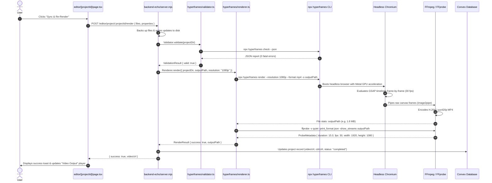

# HYPERFRAMES EDITOR INVESTIGATION AND TECHNICAL REPLACEMENT BLUEPRINT

**Document ID:** ARCH-DOC-2026-10-19-HFE  
**Date:** October 19, 2026  
**Auditor / Architect:** Autonomous AI Engineering Architecture Team  
**Scope:** HyperFrames Integration, Live Editor Suite, Scene & Element Inspector, Timeline & Animation Engine, Project Persistence, and Independent In-App Editor Replacement Architecture  
**Repository Root:** `/Users/apple/Desktop/hyparlink dashbord`  

---

## 1. Executive Summary

This technical investigation provides an exhaustive architectural audit of the video composition and editing subsystems inside the **Ollastar / Hyparlink** video creation application.

### Key Investigation Findings

1. **Dual-Tier Editor Implementation:**
   The existing Live Editor (`apps/app/src/app/[locale]/(dashboard)/editor/[projectId]/page.tsx`) operates two distinct editing modes:
   - **Mode A: Official HyperFrames Studio Embed:** Launches a background Node.js CLI process (`npx hyperframes preview <dir> --port=<port>`) and embeds the closed proprietary HeyGen HyperFrames web GUI inside a sandboxed `<iframe>`.
   - **Mode B: Custom Companion Scene Inspector:** A native Next.js split-view containing a scene list, a raw HTML composition preview `<iframe>` (`/editor/project/:projectId/raw/index.html`), a 5-field basic visual property editor, a raw source code `<textarea>`, and a static timeline block bar.

2. **The "Individual Element Editing" Illusion in Current Scene Inspector:**
   In the custom companion Scene Inspector, **individual element selection and visual manipulation do not exist.** Visual properties (title, subtitle, accent color, background color) are applied via rudimentary RegExp string replacements (`regex.replace(/(<h1[^>]*>)[^<]*(<\/h1>)/i, ...)`) against raw HTML markup on the filesystem. Elements cannot be clicked on the canvas, dragged, transformed, re-ordered in layers, or keyframed visually without the external `npx hyperframes preview` GUI.

3. **Rendering & Validation Lock-In:**
   All video exports (`POST /editor/project/:projectId/render` and `POST /api/generate`) execute the proprietary `npx --yes hyperframes@0.8.139 render` binary. Validation executes `npx --yes hyperframes@0.8.139 check`. The system relies on this external closed binary to boot headless Chromium, step through GSAP timelines, and pipe canvas buffers to FFmpeg.

4. **Feasibility of 100% Independent Replacement:**
   **Complete technical replacement is fully viable and straightforward.**
   - All generated video compositions already adhere to open web standards: standard HTML5, CSS3, SVG, and **GSAP 3** (`https://cdnjs.cloudflare.com/ajax/libs/gsap/3.12.5/gsap.min.js`).
   - The master timeline contract is standardized around `window.__timelines["main"] = tl; tl.seek(time);`.
   - An in-app interactive canvas (using `Moveable` / `Selecto` or a native bounding-box overlay), a multitrack timeline editor, an AST-driven visual property inspector, a Monaco code editor, and an open headless rendering pipeline (Playwright + FFmpeg) can completely replace HyperFrames while preserving 100% of existing projects and templates.

---

## 2. Current Application Architecture

The system operates across four coordinated tiers:

```mermaid
graph TD
    subgraph ClientTier [Client Tier: Next.js 14 App Router]
        DashboardNav[Left Navigation Sidebar]
        CreateVideoUI[Create Video Studio - create-video/page.tsx]
        LiveEditorUI[Live Editor Shell - editor/projectId/page.tsx]
        StudioIframe[Official Studio iframe :3055..3080]
        InspectorIframe[Raw HTML Composition Preview iframe]
        InspectorPanel[Visual & Code Inspector Tabs]
    end

    subgraph BackendTier [Backend Tier: Node.js Echo Server :4000]
        EchoServer[backend-echo/server.mjs]
        SessionMgr[Studio Session Manager]
        EditorEndpoints[GET /editor/project/:id, POST save, POST render]
        AgentEndpoints[POST /api/agent/revise-plan, revise-scene]
        LocalProjectFS[(Local Projects FS: generated-projects/)]
    end

    subgraph CompositionEngineTier [Composition & Pipeline Engine Tier]
        Pipeline[ai-composition-generator/src/pipeline/generate-video.ts]
        AgentPlanner[ai-composition-generator/src/ai/agent-planner.ts]
        ProjectScaffolder[ai-composition-generator/src/hyperframes/project-generator.ts]
        ValidatorModule[ai-composition-generator/src/hyperframes/validator.ts]
        RendererModule[ai-composition-generator/src/hyperframes/renderer.ts]
    end

    subgraph HyperFramesBinaryTier [Proprietary HyperFrames CLI Tier]
        HFStudioCLI["npx hyperframes preview (Embedded GUI)"]
        HFCheckCLI["npx hyperframes check (AST & Rule Validator)"]
        HFRenderCLI["npx hyperframes render (Headless Chromium + FFmpeg)"]
    end

    subgraph ConvexTier [Database & Asynchronous Storage Tier]
        ConvexDB[(Convex Cloud / Local DB)]
        ProjectsTable[projects table]
        JobsTable[jobs table]
        AssetsTable[assets table]
    end

    LiveEditorUI -->|POST /editor/session/:id| EchoServer
    EchoServer -->|Spawns npx hyperframes preview| SessionMgr
    SessionMgr -->|Runs background process| HFStudioCLI
    HFStudioCLI -.->|iframe embed :3056| StudioIframe
    LiveEditorUI -->|GET /editor/project/:id/raw/*| EchoServer
    EchoServer -->|Streams index.html + compositions/| InspectorIframe
    InspectorPanel -->|POST /editor/project/:id/save| EchoServer
    EchoServer -->|Writes HTML/JSON back to disk| LocalProjectFS
    InspectorPanel -->|POST /editor/project/:id/render| EchoServer
    EchoServer -->|Executes check & render| ValidatorModule
    ValidatorModule -->|Executes CLI| HFCheckCLI
    EchoServer -->|Executes render CLI| RendererModule
    RendererModule -->|Spawns Chromium + FFmpeg| HFRenderCLI
    RendererModule -->|MP4 Output| LocalProjectFS
    EchoServer -->|Uploads MP4 & updates status| ConvexDB
    ConvexDB -->|Real-time reactive subscription| LiveEditorUI
```



---

## 3. Existing Editor Interface Inventory

The primary editor interface is located in [`apps/app/src/app/[locale]/(dashboard)/editor/[projectId]/page.tsx`](file:///Users/apple/Desktop/hyparlink%20dashbord/apps/app/src/app/%5Blocale%5D/%28dashboard%29/editor/%5BprojectId%5D/page.tsx).

```
+---------------------------------------------------------------------------------------------------------------+
|  < Projects | Project Title [1080p] [15s @ 30fps] (Studio Live :3056) | [Official Studio] [Open Tab] [Scene Inspector] [Video Output] | [Full Screen] [Sync & Re-Render] [App] [Export] |
+---------------------------------------------------------------------------------------------------------------+
|                      |                                                                |                       |
|   SCENE NAVIGATOR    |                   COMPOSITION PREVIEW CANVAS                   |    INSPECTOR TABS     |
|   (Left Sidebar)     |                   (Center Viewport)                            |    (Right Panel)      |
|                      |                                                                |                       |
|   Scenes (3)   [+]   |   +--------------------------------------------------------+   |  [Visual]    [Code]   |
|   +--------------+   |   |                                                        |   |                       |
|   | Scene 1 (5s) |   |   |                                                        |   |  HEADLINE TEXT        |
|   | scene_01.html|   |   |                  LIVE IFRAME PREVIEW                   |   |  [ Enter title...   ] |
|   +--------------+   |   |                   (aspect-video 16:9)                  |   |                       |
|   | Scene 2 (5s) |   |   |                                                        |   |  SUBTITLE / TAGLINE   |
|   | scene_02.html|   |   |                                                        |   |  [ Enter subtitle.. ] |
|   +--------------+   |   +--------------------------------------------------------+   |                       |
|   | Scene 3 (5s) |   |                                                                |  ACCENT COLOR         |
|   | scene_03.html|   |   TIMELINE DOCK                                                |  [#00a8ff] [ Color ]  |
|   +--------------+   |   [>] 15s  | [ S1 (5s) ] [ S2 (5s) ] [ S3 (5s) ] |  1080p      |                       |
|                      |                                                                |  BACKGROUND COLOR     |
|   Engine: Studio v1  |                                                                |  [#050811] [ Color ]  |
|   Renderer: GSAP     |                                                                |                       |
|                      |                                                                |  [Save Changes]       |
+---------------------------------------------------------------------------------------------------------------+
```

---

## 4. Detailed Control Inventory & Behavior

| Control Name | Visual Location | Underlying Handler | Inputs & Outputs | Verified Action & State Mutation | HyperFrames Dependency | Replacement Necessity |
| :--- | :--- | :--- | :--- | :--- | :--- | :--- |
| **Back to Projects** | Top Bar (Left) | Next.js `<Link href="/projects">` | None | Navigates to `/projects`. Unmounts editor. | None | Keep as-is. |
| **Project Title** | Top Bar (Left) | Text span | Reads `properties.title` or `convexProject.name` | Displays project headline/name. Truncates on overflow. | None | Recreate with inline renaming capability. |
| **Resolution Badge** | Top Bar (Left) | Badge span | Reads `properties.resolution` | Displays e.g. `1080p` or `1920x1080`. | None | Recreate as resolution dropdown selector. |
| **Duration Badge** | Top Bar (Left) | Badge span | Reads `properties.duration`, `properties.fps` | Displays e.g. `15s @ 30fps`. | None | Recreate as interactive duration/framerate selector. |
| **Studio Status** | Top Bar (Left) | State badge | Reads `sessionStatus`, `session.port` | Displays connecting spinner, live port pulse, or error retry button. | **Direct** (Checks background CLI port) | Replace with internal editor engine status. |
| **Official Studio Tab** | Top Bar (Center) | `onClick={() => setActiveView("studio")}` | None | Sets `activeView = "studio"`. Displays embedded HyperFrames Studio `<iframe>`. | **Direct** (Embeds external closed GUI) | **Remove completely** once custom editor is live. |
| **Open Tab Button** | Top Bar (Center) | `<a>` link with `session.studioUrl` | `session.studioUrl` | Opens `http://localhost:<port>/#project/<name>` in an external tab. | **Direct** (HyperFrames CLI web GUI) | Remove when replacement editor is active. |
| **Scene Inspector Tab** | Top Bar (Center) | `onClick={() => setActiveView("inspector")}` | None | Sets `activeView = "inspector"`. Displays companion 3-column workspace. | None | **Base architecture for replacement editor.** |
| **Video Output Tab** | Top Bar (Center) | `onClick={() => setActiveView("video")}` | `renderedVideoUrl` | Sets `activeView = "video"`. Shows `<video>` player for rendered MP4. | None | Keep and enhance with comparison split-view. |
| **Full Screen Button** | Top Bar (Right) | `toggleFullscreen()` | DOM element ref | Enters/exits fullscreen via HTML5 Fullscreen API (`requestFullscreen`). | None | Keep as-is. |
| **Sync & Re-Render** | Top Bar (Right) | `handleSyncAndRender()` | Current `files` and `properties` | Sends `POST /editor/project/:id/render`, validates via CLI, renders MP4 via CLI, updates Convex project record. | **Direct** (Invokes CLI validator & renderer) | Replace backend rendering engine with open pipeline. |
| **Desktop App Button** | Top Bar (Right) | `handleOpenDesktop()` | `POST .../desktop-open` | Dispatches macOS shell open for native HyperFrames desktop binary. | **Direct** | Deprecate in favor of web-native editing. |
| **Export ZIP Button** | Top Bar (Right) | `handleExportZip()` | `GET .../export` | Streams project folder as a `.zip` archive via archiver. | None | Keep as-is (useful backup & export utility). |
| **Scene List Item** | Left Panel | `onClick={() => { setActiveSceneId; setSelectedFile }}` | Scene ID, scene filename | Sets active scene and loads `compositions/scene_XX.html` into code editor and properties. | None | Recreate as interactive scene card with drag-to-reorder. |
| **Duplicate Scene Button** | Left Panel (Header) | `onClick` inline handler | Existing HTML content | Clones active scene file to `compositions/scene_0N.html`, appends to `scenes[]` array, sets `hasUnsavedChanges = true`. | None | Recreate with full AST cloning and timeline repositioning. |
| **Replay Timeline Button**| Preview Header | `onClick={() => setPreviewKey(Date.now())}` | None | Updates React `key` on preview `<iframe>`, forcing iframe reload. | Partial (Reloads iframe) | Replace with real playhead seek and play/pause controls. |
| **Play/Restart Button** | Timeline Bar (Left) | `onClick={() => setPreviewKey(Date.now())}` | None | Same as replay button (reloads iframe). | Partial | Replace with frame-accurate transport controls (Play/Pause/Step). |
| **Timeline Scene Blocks**| Timeline Bar (Center)| `onClick={() => setActiveSceneId(s.id)}` | Scene array | Displays proportional scene duration blocks `S1 (5s)`, `S2 (5s)`. Clicking switches active scene. | None | **Replace with full multitrack timeline editor.** |
| **Visual Properties Tab**| Right Panel Header | `onClick={() => setActiveInspectorTab("visual")}` | None | Switches right panel to visual inputs (title, subtitle, colors, duration). | None | Expand into comprehensive visual property inspector. |
| **Source Code Tab** | Right Panel Header | `onClick={() => setActiveInspectorTab("code")}` | None | Switches right panel to target file dropdown and raw `<textarea>`. | None | Replace `<textarea>` with Monaco Code Editor. |
| **Headline Input** | Right Panel (Visual)| `handlePropertyChange("title", val)` | String text | Mutates `properties.title`, runs RegExp replace on `<h1>` in active file. | None | Recreate with two-way AST binding and canvas selection. |
| **Subtitle Input** | Right Panel (Visual)| `handlePropertyChange("subtitle", val)` | String text | Mutates `properties.subtitle`, runs RegExp replace on `<p class="...sub...">`. | None | Recreate with two-way AST binding. |
| **Accent Color Picker** | Right Panel (Visual)| `handlePropertyChange("accentColor", val)` | Hex color string | Mutates `properties.accentColor`, runs RegExp replace on accent hex codes in file. | None | Recreate with color picker + design token system. |
| **Background Color** | Right Panel (Visual)| `handlePropertyChange("backgroundColor", val)` | Hex color string | Mutates `properties.backgroundColor`, runs RegExp replace on CSS background. | None | Recreate with solid/gradient/image background controls. |
| **Duration Input** | Right Panel (Visual)| `handlePropertyChange("duration", val)` | Number (seconds) | Mutates `properties.duration`, sets `hasUnsavedChanges = true`. | None | Recreate with timeline duration synchronization. |
| **Save Inspector Changes**| Right Panel (Visual)| `handleSave()` | `files`, `properties` | Sends `POST /editor/project/:id/save`. Backend creates `.backups/<timestamp>` and writes files. | None | Keep save endpoint, add automatic debounce autosave. |
| **Target File Dropdown** | Right Panel (Code) | `onChange={(e) => setSelectedFile(e.target.value)}` | File keys in `files` state | Switches active file displayed in raw `<textarea>`. | None | Recreate as multi-tab file explorer in code editor. |
| **Raw Code Textarea** | Right Panel (Code) | `handleCodeChange(val)` | Raw file string | Updates `files[selectedFile]` string, sets `hasUnsavedChanges = true`. | None | Replace with Monaco Editor with syntax highlighting & linting. |
| **Save Code Changes** | Right Panel (Code) | `handleSave()` | `files`, `properties` | Writes textarea contents to disk via `/save` endpoint. | None | Connect to Monaco Editor save command (Ctrl+S / Cmd+S). |

---

## 5. Scene and Composition Management Deep Dive

### 5.1 Representation on Disk & in Memory
Projects are stored as standalone filesystem directories under `ai-composition-generator/generated-projects/<projectId>/`:
```
generated-projects/<projectId>/
├── meta.json                # Project resolution, framerate, duration, scene breakdown
├── project.json             # HyperFrames project manifest
├── index.html               # Master root composition
├── data-config.js           # Dynamic data bindings & theme configuration
├── .backups/                # Timestamped backup archives from save operations
├── compositions/
│   ├── scene_01.html        # Scene 1 HTML + CSS + GSAP timeline
│   ├── scene_02.html        # Scene 2 HTML + CSS + GSAP timeline
│   └── scene_03.html        # Scene 3 HTML + CSS + GSAP timeline
└── assets/                  # Local media assets (images, logos, audio)
```

### 5.2 The Master Composition Contract (`index.html`)
The root `index.html` file binds all individual scene compositions together using custom `data-*` attributes:
```html
<div class="composition master-composition" 
     data-composition-id="main" 
     data-start="0" 
     data-duration="15" 
     data-width="1920" 
     data-height="1080">
  <div id="scene-01" class="scene-container" 
       data-composition-id="scene-01" 
       data-composition-src="compositions/scene_01.html" 
       data-start="0" 
       data-duration="5"></div>
  <div id="scene-02" class="scene-container" 
       data-composition-id="scene-02" 
       data-composition-src="compositions/scene_02.html" 
       data-start="5" 
       data-duration="5"></div>
  <div id="scene-03" class="scene-container" 
       data-composition-id="scene-03" 
       data-composition-src="compositions/scene_03.html" 
       data-start="10" 
       data-duration="5"></div>
</div>
```

### 5.3 Scene Lifecycle Operations

| Operation | Current Implementation | Underlying Mechanics | Verification Status |
| :--- | :--- | :--- | :--- |
| **Creating a Scene** | UI Button in Scene Inspector | Duplicates active scene template to `compositions/scene_0N.html`. Appends scene metadata to `scenes[]`. | **Verified** |
| **Deleting a Scene** | Not implemented in Inspector UI | Supported only inside official Studio iframe or via file system deletion. | **UI Placeholder / Missing** |
| **Duplicating a Scene** | Clone button in Scene Navigator | Copies content of active scene file, increments ID, appends to `scenes[]`. | **Verified** |
| **Renaming a Scene** | Not implemented in Inspector UI | File names are static (`scene_01.html`). Titles exist only as `meta.title`. | **Not Implemented** |
| **Selecting a Scene** | Scene Navigator card click | Sets `activeSceneId` and `selectedFile`. | **Verified** |
| **Reordering Scenes** | Not implemented in Inspector UI | Supported only inside official Studio iframe. | **Missing in Companion UI** |
| **Changing Duration** | Duration input field | Updates global duration property; individual scene durations are not recalculated. | **Partially Implemented** |

---

## 6. Individual Visual Element Editing Investigation

This is the most critical architectural finding of the investigation:

### 6.1 How Visual Elements Are Handled Currently
- In the **Official Studio iframe**, elements with `data-hf-id="hf-xxxx"` can be selected in the proprietary HeyGen canvas.
- In the **Scene Inspector**, there is **no visual canvas selection mechanism**. 
- Visual editing is limited to four regex string replacements executed in [`editor/[projectId]/page.tsx`](file:///Users/apple/Desktop/hyparlink%20dashbord/apps/app/src/app/%5Blocale%5D/%28dashboard%29/editor/%5BprojectId%5D/page.tsx#L373-L404):
  ```typescript
  // 1. Headline
  updatedContent.replace(/(<h1[^>]*>)[^<]*(<\/h1>)/i, `$1${value}$2`);
  // 2. Subtitle
  updatedContent.replace(/(<p[^>]*class="[^"]*sub[^"]*"[^>]*>)[^<]*(<\/p>)/i, `$1${value}$2`);
  // 3. Accent Color
  updatedContent.replace(/(#00a8ff|#00d4ff|#ffd700)/gi, value);
  // 4. Background Color
  updatedContent.replace(/background(?:-color)?:\s*(#[a-fA-F0-9]{3,8}|rgba?\([^)]+\))/i, `background: ${value}`);
  ```

### 6.2 Element Support Matrix

| Element Type | Visual Selection on Canvas | Property Panel Support | Source Code Editing | Rendered Output | Status in Companion Inspector |
| :--- | :--- | :--- | :--- | :--- | :--- |
| **Headings (`<h1>`, `<h2>`)** | None (No canvas handles) | Text input only (regex) | Full (raw HTML text) | Full | **Primitive Text Replacement** |
| **Paragraphs & Subtitles** | None | Text input only (regex) | Full | Full | **Primitive Text Replacement** |
| **Images & Logos (``)** | None | None | Full | Full | **Source Code Only** |
| **Videos (`<video>`)** | None | None | Full | Full | **Source Code Only** |
| **Background Colors** | None | Color picker (regex) | Full | Full | **Primitive Color Replacement** |
| **Gradients** | None | None | Full | Full | **Source Code Only** |
| **Shapes & Dividers (`<div>`, `<svg>`)** | None | None | Full | Full | **Source Code Only** |
| **Charts & Infographics** | None | None | Full | Full | **Source Code Only** |
| **Audio Elements (`<audio>`)** | None | None | Full | Full | **Source Code Only** |
| **Keyframe / Motion Values** | None | None | Full (raw JS script) | Full | **Source Code Only** |

### 6.3 Technical Requirement for Independent Replacement
To provide true visual element editing without HyperFrames, the replacement editor must implement:
1. **Interactive Selection Overlay:** An SVG/HTML bounding box that hovers over elements inside the preview iframe, showing resize handles, rotation handles, and drag anchors.
2. **DOM AST Parser:** An in-memory DOM representation (using standard `DOMParser` or a lightweight JSON tree) that binds visual handles directly to DOM nodes without fragile regexes.
3. **Property Inspector:** Contextual side-panels that dynamically adapt based on selected element type (`TextNode` -> Typography, `ImageNode` -> Sizing/Crop, `ShapeNode` -> Fill/Stroke/Border).

---

## 7. Timeline Architecture Investigation

### 7.1 Existing Timeline Features Audit

| Timeline Feature | Current Implementation in Inspector | Verification Status | Source Code Reference |
| :--- | :--- | :--- | :--- |
| **Timeline Ruler & Timestamps** | Static labels only (`Duration: 15s`, `30 FPS`) | **UI Placeholder** | `editor/[projectId]/page.tsx:965` |
| **Playhead Marker** | None | **Not Implemented** | N/A |
| **Play/Pause Transport Controls**| Reload button only (`setPreviewKey(Date.now())`) | **Primitive Fallback** | `editor/[projectId]/page.tsx:955` |
| **Scene Clips** | Static flex boxes (`S1 (5s)`, `S2 (5s)`) | **Implemented & Verified** | `editor/[projectId]/page.tsx:975` |
| **Multiple Tracks** | None (single row of scenes) | **Not Implemented** | N/A |
| **Element Layer Tracks** | None | **Not Implemented** | N/A |
| **Clip Trimming Handles** | None | **Not Implemented** | N/A |
| **Drag & Drop Reordering** | None | **Not Implemented** | N/A |
| **Snap to Grid / Playhead** | None | **Not Implemented** | N/A |
| **Zoom In / Zoom Out** | None | **Not Implemented** | N/A |
| **Track Mute / Visibility** | None | **Not Implemented** | N/A |
| **Keyframe Markers** | None | **Not Implemented** | N/A |

### 7.2 Analysis
The existing Scene Inspector timeline is a visual display block rather than an interactive timeline editor. It provides no playhead scrub, no multi-track layering, and no element-level duration adjustments. The official Studio iframe provides a proprietary timeline, but users cannot interact with it programmatically from our Next.js application.

---

## 8. Animation Engine Investigation

### 8.1 How Animations Are Defined and Run
All compositions generated by the application rely on **GSAP 3.12.5**:
```javascript
// Paused Timeline Contract
window.__timelines = window.__timelines || {};
const tl = gsap.timeline({ paused: true });
window.__timelines["scene-01"] = tl;

// Example Keyframe Sequence:
tl.fromTo(".accent-tag", 
  { opacity: 0, y: -20 }, 
  { opacity: 1, y: 0, duration: 0.9, ease: "power3.out" }, 
  0.3
);
tl.fromTo(".title-main", 
  { opacity: 0, y: 35 }, 
  { opacity: 1, y: 0, duration: 1.2, ease: "power3.out" }, 
  0.6
);
tl.seek(0);
```

### 8.2 Seeking & Deterministic Reproduction
- Because timelines are initialized with `{ paused: true }`, seeking to any timestamp `t` is 100% deterministic:
  ```javascript
  tl.pause(timestampInSeconds);
  ```
- This means the entire animation state (transforms, opacities, clip paths, SVG strokes) can be controlled via standard `window.postMessage` to the preview `<iframe>`.
- **HyperFrames dependency for animation:** **Zero.** HyperFrames does not provide a custom animation runtime; it simply executes GSAP in a browser. We can retain standard GSAP across the entire replacement editor.

---

## 9. Source Code Editing Investigation

### 9.1 Existing Source Editor Implementation
- Implemented as a standard HTML `<textarea>` in [`editor/[projectId]/page.tsx`](file:///Users/apple/Desktop/hyparlink%20dashbord/apps/app/src/app/%5Blocale%5D/%28dashboard%29/editor/%5BprojectId%5D/page.tsx#L1180-L1200):
  ```tsx
  <textarea
    value={files[selectedFile] || ""}
    onChange={(e) => handleCodeChange(e.target.value)}
    rows={20}
    className="w-full flex-1 rounded-md border border-border bg-black/90 p-3 text-[11px] font-mono ..."
    spellCheck={false}
  />
  ```
- **Capabilities & Deficiencies:**
  - Can edit any file returned by `GET /editor/project/:projectId` (`index.html`, `project.json`, `meta.json`, `compositions/*.html`).
  - No syntax highlighting, no auto-closing tags, no line numbers, no linting, no error markers.
  - Saving writes directly to disk via `POST /editor/project/:projectId/save`.
  - Timestamped backup is created before writing: `projectDir/.backups/<timestamp>/`.
  - Modifying code while visual properties are edited can lead to overwrite collisions because both update the same file strings in memory.

### 9.2 Replacement Recommendation
- Replace `<textarea>` with **Monaco Editor** (`@monaco-editor/react`).
- Support split tabs (HTML, CSS, JS).
- Synchronize Monaco edits with the interactive preview via bidirectional AST updates.

---

## 10. Preview and Video Rendering Pipeline

### 10.1 Complete Rendering Execution Trace



### 10.2 Technical Dependency Analysis: Can Rendering Work Without HyperFrames?
- **Currently:** No, because `Renderer.render` directly invokes `npx hyperframes render`.
- **How to replace it:**
  HyperFrames render does three simple things:
  1. Launches Playwright/Puppeteer with a viewport matching the video resolution (e.g., `1920x1080`).
  2. Opens `file://${projectDir}/index.html`.
  3. Steps through the timeline from frame `0` to frame `totalFrames`, capturing each frame as a PNG/JPEG buffer:
     ```javascript
     for (let f = 0; f < totalFrames; f++) {
       await page.evaluate((time) => window.__timelines.main.pause(time), f / fps);
       const buffer = await page.screenshot({ type: "jpeg", quality: 95 });
       ffmpegProcess.stdin.write(buffer);
     }
     ```
  4. FFmpeg compresses the stream into H.264 MP4.
  Because **Playwright is already installed in `devDependencies`** (`playwright: ^1.64.1`) and **FFmpeg is already installed and verified on the host system**, an in-house renderer can be built in less than 200 lines of TypeScript, eliminating HyperFrames entirely.

---

## 11. Project Storage and Persistence Lifecycle

### 11.1 Persistence Architecture

| Data Entity | Primary Storage Location | Persistence Format | Backup & Recovery Mechanism |
| :--- | :--- | :--- | :--- |
| **Project Record & Metadata** | Convex DB (`projects` table) | JSON Document (Schema validated) | Convex automatic cloud replication |
| **Project Source Files** | Local Filesystem (`generated-projects/<id>/`) | HTML5, CSS3, JS, JSON | `projectDir/.backups/<timestamp>/` |
| **Rendered Master MP4** | Local Disk (`outputs/`) & Cloud Storage | H.264 / AAC MP4 file | Re-renderable from source files at any time |
| **Workspace Media Assets** | Convex DB (`assets` table) & Local Disk | Binary media files + Metadata row | Referenced by absolute & relative paths |
| **Production Plan** | Convex DB (`projects.productionPlan`) | Structured JSON plan object | Stored in project row |

### 11.2 Convex Integration Details
- Tables involved:
  - `projects`: Contains project status, duration, resolution, storage URLs, production plan.
  - `jobs`: Tracks background rendering jobs and progress events.
  - `assets`: Catalogs uploaded and generated images/audio.
- Project creation mutation: `api.projects.create`.
- Plan update mutation: `api.projects.saveProductionPlan`.
- Approval and render trigger: `api.projects.approveAndRenderPlan`.

---

## 12. HyperFrames Dependency Map

```mermaid
graph LR
    subgraph DirectDependencies [Direct HyperFrames Dependencies]
        D1["hyperframes npm package v0.8.139"]
        D2["npx hyperframes preview (Official Studio)"]
        D3["npx hyperframes check (Validator)"]
        D4["npx hyperframes render (Renderer)"]
    end

    subgraph IndependentComponents [Independent Components (Keep)]
        I1["Next.js App Router Shell"]
        I2["Convex Database & Auth"]
        I3["GSAP 3 Animation Timelines"]
        I4["Ollima AI Planner"]
        I5["FFmpeg & FFprobe Audio/Video Engine"]
        I6["HTML5 / CSS3 / SVG Composition Syntax"]
        I7["Workspace Media Asset Manager"]
    end

    D1 -.->|Used in| D3
    D1 -.->|Used in| D4
    D2 -.->|Embedded in| LiveEditorPage[editor/projectId/page.tsx]
    D3 -.->|Called in| ValidatorModule[hyperframes/validator.ts]
    D4 -.->|Called in| RendererModule[hyperframes/renderer.ts]
```

### Complete Classification of Dependencies

| Component | Source File | Dependency Mechanism | Impact of Removal | Replacement Strategy | Migration Risk |
| :--- | :--- | :--- | :--- | :--- | :--- |
| **Studio GUI Embed** | `editor/[projectId]/page.tsx` | Background CLI port + `<iframe>` | Loss of external GUI | Build native Next.js canvas & properties panel | Low (Inspector already exists) |
| **Composition Validator** | `ai-composition-generator/.../validator.ts` | `npx hyperframes check` | Loss of linting CLI | Implement lightweight DOM linter (checks composition IDs & durations) | Low |
| **Video Renderer** | `ai-composition-generator/.../renderer.ts` | `npx hyperframes render` | Cannot produce MP4s | Implement Playwright + FFmpeg frame capture pipeline | Medium (Requires thorough testing) |
| **Project Scaffolding** | `ai-composition-generator/.../project-generator.ts`| Generates `project.json` | None | Retain HTML/CSS template generation; remove `project.json` | Zero |

---

## 13. Existing Implementation Gaps & Limitations

1. **No Canvas Element Selection:** Users cannot click an element on the preview canvas to inspect or move it.
2. **Regex-Based Property Editing:** Changing a title or color runs regular expressions across the HTML string, which fails on non-standard markup.
3. **Static Timeline Bar:** The timeline displays scene duration blocks but lacks a movable playhead, tracks, zooming, snapping, or trimming.
4. **No Direct Asset Drag-and-Drop:** Assets cannot be dragged from the asset library directly onto the canvas.
5. **No Layer Management:** Users cannot re-order z-indexes or view an element hierarchy tree.
6. **Double-Process Overhead:** Running `npx hyperframes preview` alongside Next.js consumes unnecessary RAM and local ports.
7. **Potential Port Collisions:** Studio CLI port allocation (3055–3080) can fail in multi-user or containerized environments.

---

## 14. Architecture of the Replacement Editor

### 14.1 Layout Specification (Based on Reference UI)

```
+-------------------------------------------------------------------------------------------------------------------------+
| [Ollastar] Projects / My Commercial  | 1080p v | 30 FPS v | 00:04.2 / 00:15.0 | [Undo] [Redo] | [Full Screen] | [Export MP4] |
+-------------------------------------------------------------------------------------------------------------------------+
| LEFT PANEL (280px)  | CENTER CANVAS VIEWPORT (Flexible)                                     | RIGHT INSPECTOR (320px)   |
| [Scenes][Assets][Code] |                                                                       | [Design] [Layers] [Motion] |
|                     |   +---------------------------------------------------------------+   |                           |
| Scene 1: Intro (5s) |   |                                                               |   | SELECTED: .title-main     |
| [Thumbnail]         |   |                 INTERACTIVE PREVIEW CANVAS                    |   |                           |
|                     |   |   +-------------------------------------------------------+   |   | Typography:               |
| Scene 2: Hero (5s)  |   |   |  [Bounding Box Handles: Resize / Drag / Rotate]       |   |   | Font: Outfit              |
| [Thumbnail]         |   |   |  "RETRO DIVINE"                                       |   |   | Size: 64px  Weight: 800   |
|                     |   |   +-------------------------------------------------------+   |   | Color: #FFFFFF            |
| Scene 3: CTA (5s)   |   |                                                               |   |                           |
| [Thumbnail]         |   |                                                               |   | Transform:                |
|                     |   +---------------------------------------------------------------+   |   | X: 140px  Y: 240px        |
| [+ Add Scene]       |   [|<] [<<] [ > Play ] [>>] [>|]  Zoom: [100% v]  Grid: [x] Snap: [x] |   | Opacity: 100%             |
+---------------------+-----------------------------------------------------------------------+---------------------------+
| MULTITRACK TIMELINE DOCK (Height: 260px)                                                                                |
| [T] Ruler:  00:00        00:02        00:04        00:06        00:08        00:10        00:12        00:14        00:16 |
| [Playhead]--------------|---------------------------------------------------------------------------------------------|
| Track 1 (Text):         [ Scene 1 Headline ]             [ Scene 2 Features ]           [ Scene 3 CTA Button ]        |
| Track 2 (Visuals):      [ Batman Artwork Push-In ]       [ Feature Callouts ]           [ End Logo Reveal ]           |
| Track 3 (Audio):        [ Cinematic Luxury Music Bed (Ducking: -12dB) ----------------------------------------------] |
| Zoom: [-]---[+] | Snapping: ON | Timecode: 00:04:06 (Frame 126)                                                        |
+-------------------------------------------------------------------------------------------------------------------------+
```

### 14.2 Key Architectural Subsystems for the Replacement

#### Subsystem 1: Interactive Canvas & Selection Engine
- **Preview Mechanism:** Use a sandboxed `<iframe>` that loads the composition.
- **Selection Overlay:** Position an absolute SVG/HTML layer directly over the `<iframe>`. When the user hovers or clicks an element, query its bounding box via `element.getBoundingClientRect()` inside the iframe and render SVG transformation handles (8 resize points, 1 rotation stalk).
- **Recommended Library:** `moveable` + `selecto` (or `@daybrush/drag` / native React pointer events).

#### Subsystem 2: Contextual Property Inspector
- Maps directly to the selected element’s computed styles and DOM attributes:
  - Text elements -> Font family (Google Fonts integration), weight, size, letter spacing, text color, alignment.
  - Box/Container elements -> Width, height, padding, margin, border-radius, background (solid, gradient, image), box-shadow.
  - Media elements -> Source URL, aspect ratio, object-fit (`cover` / `contain`), border-radius.
  - Motion elements -> Entrance animation type, duration, ease, delay, start timestamp.

#### Subsystem 3: Multitrack Timeline & Playhead Engine
- **Time Base:** Global time state measured in milliseconds and frames (e.g., 30 FPS = 33.33ms per frame).
- **Transport Synchronization:**
  - Scrubbing the playhead dispatches a `seek` event:
    ```typescript
    iframeRef.current.contentWindow.postMessage({
      type: "SEEK_TIMELINE",
      timestamp: currentTimeInSeconds,
    }, "*");
    ```
  - An event listener inside the composition responds:
    ```javascript
    window.addEventListener("message", (e) => {
      if (e.data.type === "SEEK_TIMELINE") {
        window.__timelines.main.pause(e.data.timestamp);
      }
    });
    ```

#### Subsystem 4: Standalone Headless Rendering Engine (Replacing `hyperframes render`)
- Implement `ai-composition-generator/src/render/engine.ts` using **Playwright** + **FFmpeg**:
  ```typescript
  import { chromium } from "playwright";
  import { spawn } from "node:child_process";

  export async function renderCompositionToMp4({ projectDir, outputPath, fps = 30, duration = 15 }) {
    const browser = await chromium.launch({ headless: true });
    const page = await browser.newPage({ viewport: { width: 1920, height: 1080 } });
    await page.goto(`file://${projectDir}/index.html`);

    const ffmpeg = spawn("ffmpeg", [
      "-y",
      "-f", "image2pipe",
      "-vcodec", "mjpeg",
      "-framerate", String(fps),
      "-i", "-",
      "-c:v", "libx264",
      "-pix_fmt", "yuv420p",
      "-preset", "fast",
      outputPath,
    ]);

    const totalFrames = Math.round(duration * fps);
    for (let i = 0; i < totalFrames; i++) {
      const time = i / fps;
      await page.evaluate((t) => window.__timelines.main.pause(t), time);
      const screenshot = await page.screenshot({ type: "jpeg", quality: 95 });
      ffmpeg.stdin.write(screenshot);
    }

    ffmpeg.stdin.end();
    await new Promise((res) => ffmpeg.on("close", res));
    await browser.close();
  }
  ```

---

## 15. Feature Comparison & Replacement Matrix

| Feature | Current Implementation | Source File | Current Behavior | Verification Status | HyperFrames Dependency | Replacement Requirement | Migration Risk |
| :--- | :--- | :--- | :--- | :--- | :--- | :--- | :--- |
| **Studio View** | `<iframe>` embed | `editor/[projectId]/page.tsx:780` | Displays external CLI web GUI | Verified | **100% Dependent** | Replace with native React layout | Low |
| **Scene Inspector** | Custom 3-column UI | `editor/[projectId]/page.tsx:792` | Basic visual + code inspector | Verified | None | Expand into primary editor | Zero |
| **Element Selection**| None (in companion UI) | N/A | Cannot select canvas elements | Missing | Required CLI GUI | Build interactive canvas overlay | Medium |
| **Property Editing** | RegExp string replace | `editor/[projectId]/page.tsx:373` | Modifies 4 fields via regex | Primitive | None | Build AST-backed inspector | Low |
| **Timeline Scrubber**| None | N/A | Reloads iframe only | Missing | Required CLI GUI | Build multitrack timeline | Medium |
| **Code Editor** | Plain `<textarea>` | `editor/[projectId]/page.tsx:1183`| Edits raw text, no highlighting | Primitive | None | Install Monaco Editor | Zero |
| **Project Save** | Direct file write | `backend-echo/server.mjs:2241` | Writes files with `.backups/` | Verified | None | Keep backend save logic | Zero |
| **Export MP4** | CLI render command | `ai-comp.../renderer.ts:90` | Executes `hyperframes render` | Verified | **100% Dependent** | Replace with Playwright + FFmpeg | Medium |
| **Validation** | CLI check command | `ai-comp.../validator.ts:38` | Executes `hyperframes check` | Verified | **100% Dependent** | Replace with DOM/AST validator | Low |
| **Desktop Open** | Shell `open` command | `backend-echo/server.mjs:2648` | Opens macOS desktop binary | Verified | **100% Dependent** | Deprecate in favor of web | Zero |

---

## 16. Implementation Roadmap

```mermaid
gantt
    title Independent Video Editor Replacement Roadmap
    dateFormat  YYYY-MM-DD
    section Phase 1: Core Foundation
    Stage 1: DOM AST & Canvas Engine         :done, s1, 2026-10-20, 5d
    Stage 2: Element Selection & Handles      :active, s2, after s1, 5d
    section Phase 2: Inspector & Timeline
    Stage 3: Visual Property Inspector        :s3, after s2, 7d
    Stage 4: Multitrack Timeline & Scrubbing  :s4, after s3, 8d
    Stage 5: Monaco Code Editor Integration   :s5, after s4, 4d
    section Phase 3: Open Rendering Engine
    Stage 6: Playwright + FFmpeg Renderer    :s6, after s5, 7d
    Stage 7: In-House Composition Validator   :s7, after s6, 4d
    section Phase 4: Migration & Cleanup
    Stage 8: Project Migration & Verification :s8, after s7, 5d
    Stage 9: Complete HyperFrames Deletion    :s9, after s8, 3d
```

### Stage-by-Stage Breakdown

#### STAGE 1: Editor Foundation and Composition Model
- **Goal:** Establish a bi-directional data model connecting HTML/GSAP files with a structured JSON component tree.
- **Key Deliverable:** `CompositionModel` that parses `index.html` and `compositions/*.html` into structured scene objects with element IDs and timing tags.

#### STAGE 2: Interactive Canvas and Element Selection
- **Goal:** Enable users to click, highlight, and drag visual elements directly on the preview canvas.
- **Key Deliverable:** Canvas overlay component with 8 bounding-box handles, rotation controls, and hover tooltips.

#### STAGE 3: Visual Property Inspector
- **Goal:** Replace regex string replacement with dynamic, type-aware property controls.
- **Key Deliverable:** Right-hand inspector panel with Typography, Layout, Appearance, and Color picker controls.

#### STAGE 4: Scene and Layer Management
- **Goal:** Enable adding, deleting, duplicating, and reordering scenes and element layers.
- **Key Deliverable:** Scene drawer with live thumbnail generation and layer z-index reordering.

#### STAGE 5: Multitrack Timeline and Playback
- **Goal:** Deliver an interactive, professional video timeline dock.
- **Key Deliverable:** Timeline ruler, draggable playhead, multi-track clips, keyframe markers, and zoom/snapping controls.

#### STAGE 6: Animation and Keyframe Editing
- **Goal:** Allow users to adjust GSAP animations visually without typing code.
- **Key Deliverable:** Easing curve picker (`power2.out`, `elastic`, `back.out`), duration sliders, and delay markers.

#### STAGE 7: Asset Management & Drag-and-Drop
- **Goal:** Connect the workspace asset library directly to the editor canvas.
- **Key Deliverable:** Asset sidebar with drag-and-drop insertion onto the preview canvas.

#### STAGE 8: Monaco Source-Code Editor
- **Goal:** Upgrade the raw `<textarea>` to a full IDE-grade code editor.
- **Key Deliverable:** Embedded Monaco Editor with HTML, CSS, and JS syntax highlighting and instant preview syncing.

#### STAGE 9: Autosave and Version History
- **Goal:** Transparent background persistence with failure recovery.
- **Key Deliverable:** Debounced 2-second autosave, undo/redo stack (`Ctrl+Z` / `Ctrl+Y`), and visual revision comparison.

#### STAGE 10: Playwright + FFmpeg Standalone Video Renderer
- **Goal:** Eliminate the `hyperframes render` CLI dependency for MP4 export.
- **Key Deliverable:** High-performance headless frame capture engine utilizing existing Playwright and FFmpeg installations.

#### STAGE 11: End-to-End Testing and Project Verification
- **Goal:** Validate that all existing 390+ projects on disk open, edit, and render flawlessly with the new engine.
- **Key Deliverable:** Automated visual regression test suite verifying 1080p frame equivalence.

#### STAGE 12: HyperFrames CLI Removal
- **Goal:** Safely remove `hyperframes` from `package.json` and delete legacy CLI wrappers.
- **Key Deliverable:** Clean, self-contained codebase completely free of proprietary external dependencies.

---

## 17. Security & Performance Considerations

1. **Iframe Sandboxing:** The preview `<iframe>` must maintain `sandbox="allow-scripts allow-same-origin"` to prevent arbitrary parent-window navigation while permitting GSAP execution.
2. **Path Traversal Protection:** All project file endpoints (`/editor/project/:projectId/*`) must strictly validate resolved paths within `generated-projects/` to prevent directory traversal attacks (`../`).
3. **Headless Execution Isolation:** In the Playwright rendering engine, disable network access for file-based rendering (`context.route("**/*", ...)` except for verified Google Fonts CDN).
4. **Rendering Resource Governance:** Ensure only one concurrent Playwright render runs per CPU core to prevent GPU memory saturation on macOS / Linux hosts.

---

## 18. Conclusion & Blueprint Sign-Off

The existing HyperFrames integration has served as an effective bridge, but its closed CLI binary, dual-process overhead, and lack of true in-app visual selection make it a barrier to a modern creative workflow.

Because the underlying project compositions are built on standard **HTML5, CSS, and GSAP**, our application can transition smoothly to an in-house, fully interactive video editor with zero loss of existing project assets and full creative control.
